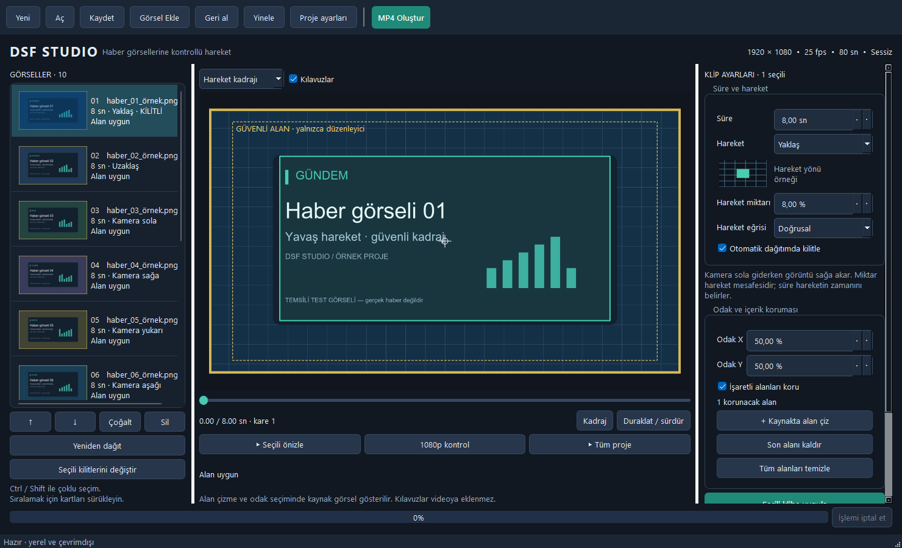

# DSF Studio

Haber görsellerini yavaş zoom/pan hareketleriyle tek **1920×1080 MP4** videoda birleştiren Windows masaüstü uygulaması. Türkçe arayüz ile görselleri sıralayın, hareket verin ve başlık, logo veya yüz gibi önemli alanların kadrajda kalmasını sağlayın. Görseller bilgisayarınızda işlenir; uygulamayı kullanmak için hesap, bulut veya yapay zekâ API'si gerekmez.

**[Windows sürümünü indir](https://github.com/ahmetmetinarslan/dsf-studio/releases/latest)** · [Test sonuçları](TEST_RESULTS.md) · [Sorun bildir](https://github.com/ahmetmetinarslan/dsf-studio/issues)



## Başka bir bilgisayarda indirip açma

1. [Releases sayfasını](https://github.com/ahmetmetinarslan/dsf-studio/releases/latest) açın. Depo özel olduğundan **ahmetmetinarslan** hesabınızla GitHub'a giriş yapın.
2. **Assets** bölümünden `DSF-Studio-1.0.0-Windows-x64.zip` dosyasını indirin. GitHub'ın otomatik oluşturduğu **Source code** arşivleri çalıştırılabilir uygulamayı içermez.
3. ZIP'e sağ tıklayıp **Tümünü ayıkla** seçin. Çıkan `DSF-Studio` klasöründeki **`DSF-Studio.exe`** dosyasını çift tıklayın.
4. Örneği denemek için **Aç** → `examples/Ornek_Haber.dsfproj` seçin. Pakette 10 temsili haber kartı ve `examples/Ornek_Haber_80sn.mp4` örnek çıktısı bulunur.

**Python veya FFmpeg kurulumu gerekmez.** Klasörün tamamını birlikte tutun; `_internal` klasörü uygulamanın bileşenlerini içerir. EXE'yi ZIP'in içinden veya bu klasörden ayırarak çalıştırmayın. Masaüstüne EXE'nin kısayolunu oluşturabilirsiniz. İnternet yalnızca paketi indirmek için gerekir.

Windows 11 x64 üzerinde test edildi. Windows 10 ve ayrı temiz Windows kurulumu henüz doğrulanmadı; ARM için yerel paket yoktur. EXE dijital imzalı değildir. Video işlemi geçici dosyalar ürettiğinden çıktı ve kullanıcı veri diskinde yeterli boş alan gerekir. Ayrı bir ekran kartı şart değildir; render CPU üzerinde çalışır.

Güncellerken yeni sürümü ayrı bir klasöre açın. Kendi `.dsfproj` dosyalarınızı ve kaynak görsellerinizi birlikte saklayın. Geliştirme klasöründeki `Baslat.cmd`, `dist/DSF-Studio/DSF-Studio.exe` varsa onu, yoksa Python geliştirme ortamını açar.

## Neler yapar?

- Yakınlaşma, uzaklaşma ve dört yönde yavaş pan; doğrusal veya yumuşak hareket eğrisi.
- Elle çizilen korunacak alanlar, odak noktası ve ayarlanabilir güvenli kenar payları.
- Güvensiz hareketi azaltma, gerekirse güvenli sabit kadraja geçme ve sonuç bilgisini gösterme.
- Sürükleyerek sıralama, çoklu seçim, toplu düzenleme, kilitleme, otomatik hareket dağıtımı, geri al/yinele.
- Seçili klip, 1080p kontrol ve tüm proje için gerçek video önizlemesi.
- Proje kaydetme/açma, eksik görseli yeniden bağlama, otomatik kurtarma ve render iptali.

| Girdi | Çıktı |
| --- | --- |
| JPG / PNG, EXIF yönü düzeltildikten sonra tam 16:9 | Tek 1920×1080 MP4 |
| Her görsel için ayrı süre ve hareket | 25 veya 50 fps, progressive |
| ICC renk profili ve saydam PNG desteği | H.264, BT.709 limited, yuv420p, sessiz |

Müzik/ses, geçiş efekti, otomatik yüz tanıma ve OCR bu sürümde bulunmaz. Kılavuzlar, korunacak alan çerçeveleri ve odak işareti çıktıya eklenmez.

## Kullanım

1. JPG/PNG dosyalarını **Görsel Ekle** ile veya sürükleyerek ekleyin. EXIF yönü düzeltildikten sonra tam 16:9 oranı gerekir. Farklı oranlar reddedilir; küçük görseller uyarıyla kabul edilir.
2. Kartları sürükleyin veya oklarla sıralayın. Ctrl/Shift ile çoklu seçin; çoğaltın veya silin.
3. Sağ panelde süre, hareket, miktar, eğri ve odağı belirleyip **Seçili klibe uygula** veya **Seçililere uygula** seçin. Süre en yakın tam kareye yuvarlanır. Miktar, çıktı boyutuna göre zoom artışı veya toplam pan mesafesidir. Kamera sola gittiğinde içerik sağa akar.
4. **Korunacak alan çiz** modunda kaynakta bir veya daha fazla dikdörtgen çizin. **Odak noktası seç** modunda kaynağa tıklayın. Alanları seçililere kopyalayabilirsiniz. Her işlemden sonra güvenlik sonucu güncellenir.
5. **Proje ayarları** altında 25/50 fps, azami büyütme, EBU grafik/aksiyon veya dört kenarı ayrı özel paylar, opak PNG zemini ve otomatik hareket kümesini seçin. **Yeniden dağıt** birden fazla seçili varsa seçilileri, aksi halde tüm projeyi etkiler. Kilitli klip değişmez.
6. **Seçili önizle**, **1080p kontrol** veya **Tüm proje** gerçek FFmpeg önizlemesini oluşturup oynatır. Zaman sürgüsü ile gezinin. **Kadraj** düzenleyiciye döner. Sarı güvenli alan, yeşil korunan alanlar ve odak işareti videoya çizilmez.
7. **Kaydet** proje JSON'unu güvenli biçimde kaydeder. Ctrl+Shift+S farklı kaydeder. Kaynaklar proje klasöründeyse göreli yollar yazılır; görselleri proje ile birlikte taşıyın. Eksik veya değişmiş dosyada **Dosyayı yeniden bağla** kullanın.
8. **MP4 Oluştur** tek sessiz H.264 dosyası üretir. İlerleme tamamlanmadan dosya doğrulanır. **İşlemi iptal et** yarım işi temizler ve eski başarılı hedefi korur.

Geri al/yinele: Ctrl+Z / Ctrl+Y. Otomatik kurtarma 30 saniyede bir ayrı dosyaya yazılır; beklenmeyen kapanış sonrası tekrar açarken önerilir. Kurtarma ve en çok sekiz video önizlemesi Windows kullanıcı veri klasöründe tutulur. Uygulama temiz kapanırken kurtarma dosyası kaldırılır.

## Güvenlik davranışı

Varsayılan güvenli pay her kenarda %5'tir. Hesapta ayrıca 2 çıktı pikseli iç pay kullanılır. Hareket azalırsa talep edilen ve uygulanan miktar gösterilir. Hareket mümkün değilse güvenli sabit kadraj açıkça belirtilir; sabit de güvensizse dışa aktarma engellenir. Alan seçilmemiş veya koruma kapalıysa içerik güvenliği doğrulanmış sayılmaz. OCR veya yüz tanıma yoktur.

Varsayılan çıktı: 1920×1080, 25p, 8 sn/görsel, H.264 libx264 CRF18 medium, yuv420p, kare piksel, progressive, BT.709 limited, ses yok, kesme geçişi. Belirli bir kanalın 1080i/MXF/ses/bit hızı kabulü doğrulanmamıştır.

## Kaynaktan geliştirme

Windows x64 ve Python **3.13.5** ile test edildi. Depoyu klonlayın veya Releases içindeki `DSF-Studio-1.0.0-Source.zip` dosyasını açın. Kaynak ZIP'i örnek videoyu ve test kanıtlarını da içerir. PowerShell'de proje klasöründe:

```powershell
py -3.13 -m venv .venv
.\.venv\Scripts\python.exe -m pip install -r requirements.lock
```

FFmpeg **8.0 full build** içinden `ffmpeg.exe` ve `ffprobe.exe` dosyalarını `tools` klasörüne koyun. Kilitli indirme:
https://github.com/GyanD/codexffmpeg/releases/download/8.0/ffmpeg-8.0-full_build.zip
Yetenek kontrolü `zoompan`, `zscale`, `scale` ve `libx264` varlığını denetler. FFmpeg dosyalarının özetleri `BUILD_INFO.json` içindedir. Çalışma zamanında indirme yapılmaz. Araçlar hazır olduğunda uygulamayı başlatın:

```powershell
.\.venv\Scripts\python.exe main.py
```

Test ve paketleme komutları:

```powershell
.\.venv\Scripts\python.exe -m pytest tests -q
.\.venv\Scripts\python.exe scripts/stage1.py
.\.venv\Scripts\python.exe scripts/make_examples.py
.\.venv\Scripts\python.exe scripts/acceptance.py
.\.venv\Scripts\python.exe scripts/gui_checks.py
.\.venv\Scripts\python.exe scripts/build_windows.py
.\.venv\Scripts\python.exe scripts/release.py
```

Paket kontrolü, paketli araçlarla yeni MP4 oluşturur ve Qt'de gerçek video karelerini oynatır:

```powershell
.\dist\DSF-Studio\DSF-Studio.exe --verify-package artifacts\package-check
```

## Mimari ve doğrulama

`motion.py` dönüşüm modeli; `safety.py` affine sınır çözücüsü; `media.py` EXIF/ICC/alpha; `model.py` sürümlü veri; `persistence.py` atomik JSON; `renderer.py` ortak FFmpeg eşlemesi; `jobs.py` arka plan QThread içinde QProcess kuyruğu; `ui.py` ve `canvas.py` masaüstü.

Önizleme ve çıktı aynı 3840×2160 ara geometriyi kullanır. RGB piksel dönüşümü, 16 bit LUT ile ters sRGB EOTF → BT.709 OETF; ardından zscale ile BT.709 matrisi ve video aralığıdır. FFmpeg'in varsayılan görüntüleme eğrisine bırakılmaz. Proje kaynak özeti, tüm planlar, fps, kare sayısı, çözünürlük, renk yolu ve renderer sürümü önizleme anahtarına dahildir. Render değişmez proje kopyasıyla çalışır; kareler Python belleğinde biriktirilmez.

**40 birim testi geçti.** Gerçek video testlerinde 10 görselden 80 saniyelik / 2000 karelik çıktı, altı hareket, korunan alanlar, 25/50 fps, 100 görsellik render ve iptal doğrulandı. Paketli EXE kendi araçlarıyla video oluşturup oynattı. Ayrıntılar ve doğrulanmamış maddeler [TEST_RESULTS.md](TEST_RESULTS.md) içindedir. Bu sonuçlar geliştirme bilgisayarındaki ölçümlerdir.

Makine tarafından üretilen kanıtlar geliştirme ortamında `artifacts`, dağıtımda `test-evidence` klasöründedir. Dağıtım kopyalarında bilgisayara özel mutlak yollar `<workspace>` ile değiştirilir; ölçümler korunur. SHA-256 özetleri Releases içindeki `SHA256.json` dosyasındadır. İndirilen ZIP'i PowerShell'de `Get-FileHash .\DSF-Studio-1.0.0-Windows-x64.zip -Algorithm SHA256` ile karşılaştırabilirsiniz.

Hata bildirirken uygulama sürümünü, Windows sürümünü, yaptığınız işlemleri ve hata metnini ekleyin. Mümkünse kişisel bilgi içermeyen küçük bir örnek proje kullanın.

## Üçüncü taraf bileşenler

Bu özel depo, uygulama ve kaynaklarını kendi bilgisayarlarınız arasında taşımak için hazırlanmıştır. Python, Qt/PySide6, Pillow ve FFmpeg bildirimleri [THIRD_PARTY_NOTICES.md](THIRD_PARTY_NOTICES.md) ve hazır paketin `licenses` klasöründedir. Harici yeniden dağıtım için aynı dosyadaki kaynak kodu sağlama durumunu inceleyin.

Teknik başvurular: [FFmpeg filtreleri](https://ffmpeg.org/ffmpeg-filters.html), [Qt QProcess](https://doc.qt.io/qtforpython-6/PySide6/QtCore/QProcess.html), [Pillow ImageCms](https://pillow.readthedocs.io/en/stable/reference/ImageCms.html).
